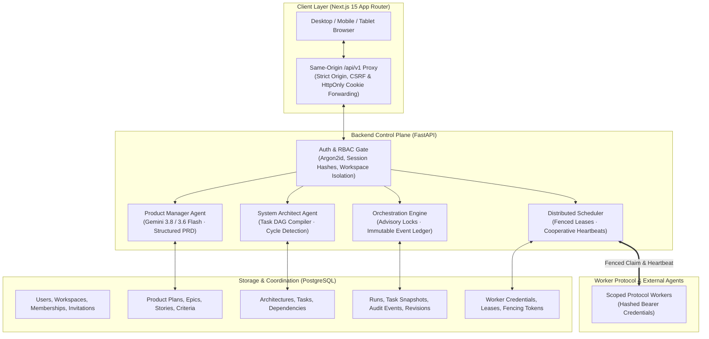

# OBRA (Orchestrated Bounded Reasoning Agents)

[](docs/VERIFICATION.md)
[](apps/api)
[](apps/web)
[](apps/api)
[](infra/compose.yaml)
[](apps/web)
[](https://ai.google.dev/)

> **A deterministic AI orchestration control plane and multi-agent software engineering platform.**  
> OBRA bridges frontier LLM reasoning with mathematical control theory: structured requirements generation, directed acyclic graph (DAG) task compilation, PostgreSQL-fenced distributed worker leasing, and immutable human governance.

---

## 🌟 Executive Overview

Most "autonomous agent" frameworks fail in production due to stochastic loop runaway, state desynchronization, unverified hallucinations, and lack of deterministic execution guarantees.

**OBRA replaces uncontrolled agent autonomy with a bounded, relational control plane:**
1. **Bounded Reasoning**: LLMs are restricted to drafting pure, structured artifacts (Product Requirements Documents and Architecture DAGs) validated against strict Pydantic schemas. They cannot execute shell scripts, run arbitrary migrations, or silently alter production databases.
2. **Deterministic Task DAG Compilation**: The System Architect compiles high-level requirements into a topologically sorted Directed Acyclic Graph (DAG) with explicit prerequisite $\rightarrow$ dependent edges, cycle prevention, and structural coverage guarantees.
3. **Relational State Machine & Monotonic Fencing**: The orchestration engine manages task dispatch through PostgreSQL advisory transaction locks, monotonic fencing tokens, leased worker heartbeats, and immutable append-only event ledgers.
4. **Human-in-the-Loop Governance**: Every major state transition (PRD approval, Architecture freeze, dispatch policy configuration, emergency run pause/resume, and reconciliation) requires cryptographic or session-bound human authority.

---

## 🏛️ System Architecture



---

## 🚀 Core Pillars & Capabilities

### 1. Product Manager Planning Agent (PRD)
- **Grounded Structured Specifications**: Ingests user project briefs and produces formal PRDs containing Epics, User Stories, and Given/When/Then acceptance criteria.
- **Strict Budget Controls**: Explicit token bounds, thinking levels (`minimal`, `low`, `medium`, `high`), content-byte caps, and hourly account rate-limits.
- **Collaborative Human Authoring**: Versioned draft copying, conflict-free revision history, and explicit Owner/Admin approval gates.
- **Provider Readiness Tripwires**: Offline validation tooling (`scripts.check_pm_config`) to verify model availability without spending quota or triggering generation.

### 2. System Architect & Task DAG Engine
- **Relational Task Decomposition**: Transforms approved PRDs into typed engineering tasks with explicit dependencies ($A \rightarrow B$).
- **Topological & Cycle Validation**: Enforces directed acyclic properties, detecting self-references, circular dependencies, and cross-project leaks before persistence.
- **Structural Coverage Matrix**: Validates that every story and acceptance criterion from the PRD is structurally mapped to corresponding architectural tasks.
- **Immutable Proposals**: Approved architectural proposals are cryptographically frozen; any proposed edits fork into distinct, revision-tracked human drafts.

### 3. Deterministic Orchestration Engine
- **Snapshot Isolation**: When an execution run is triggered, OBRA takes an immutable snapshot of all tasks, dependencies, and PRD references. Subsequent planning changes never mutate active runs.
- **Monotonic Revision Sequence**: State transitions are serialized under PostgreSQL advisory locks with strictly incrementing revision counters.
- **Tamper-Evident Event Ledger**: Every state change (run creation, task eligibility, claim, heartbeat, pause, cancellation) writes to an append-only event log protected by database triggers.
- **Root Task Resolution**: The engine dynamically evaluates prerequisite completion to calculate root task eligibility while isolating unexecuted tasks in `awaiting_executor`.

### 4. Distributed Scheduler & Monotonic Fencing
- **Dedicated Scoped Credentials**: Workers authenticate via hashed, opaque Bearer tokens provisioned locally by operators (no public self-registration).
- **Leased Ownership**: Tasks are claimed with time-bounded leases and cooperative heartbeats. Stale workers lose ownership deterministically upon lease expiry.
- **Fencing Tokens**: Prevents split-brain races from delayed or revived workers through monotonically incrementing lease fencing numbers.
- **Pre-Ack Recovery & Reconciliation**: Distinguishes between unacknowledged dispatches (safely recovered) and acknowledged in-flight operations (reconciled through explicit human risk review).

### 5. Multi-Tenant Workspace & Security Hardening
- **RBAC Matrix**: Enforces four strict roles: **Owner**, **Admin**, **Member**, and **Viewer**. Final workspace owners cannot be demoted without ownership transfer.
- **Argon2id Authentication**: Password verification uses memory-hard Argon2id salts with 15–128 Unicode code point passphrase constraints.
- **CSRF & Origin Enforcement**: Double-submit protection combining SameSite cookies, session-bound HMAC CSRF tokens, and verified HTTP Origin headers.
- **Quarantined Legacy Migration**: Pre-existing data is held in an inaccessible, restricted workspace accessible only via offline CLI (`scripts.claim_legacy`).

---

## 📂 Repository Structure

```text
OBRA/
├── apps/
│   ├── api/                           # Backend Control Plane (FastAPI + SQLAlchemy 2)
│   │   ├── migrations/                # Alembic schema migrations (0001 -> Stage05C)
│   │   ├── orba/                      # Core application modules
│   │   │   ├── auth.py                # Session management & Argon2id verification
│   │   │   ├── config.py              # Pydantic Settings & environment validation
│   │   │   ├── pm.py / pm_service.py  # Product Manager agent & prompt orchestration
│   │   │   ├── architect.py           # System Architect agent & task graph compiler
│   │   │   ├── orchestration*.py      # State machine, snapshotting & event ledger
│   │   │   ├── scheduler*.py          # Worker dispatch, fencing & lease management
│   │   │   └── human_control*.py      # Human dispatch policy & pause/resume gates
│   │   ├── scripts/                   # CLI tools, verification harnesses & proofs
│   │   └── tests/                     # 800+ deterministic unit, race & contract tests
│   └── web/                           # Frontend Dashboard (Next.js 15 App Router)
│       ├── src/
│       │   ├── app/                   # App Router pages & API proxy route handler
│       │   ├── components/            # UI components (Radix / Tailwind / Lucide)
│       │   │   ├── execution-plan.tsx # Live DAG execution & state viewer
│       │   │   ├── architecture*.tsx  # Task graph visualizer & editor
│       │   │   ├── product-plan.tsx   # PRD review, editing & approval
│       │   │   └── human-controls.tsx # Human dispatch governance & run controls
│       │   └── lib/                   # Typed API clients & state utilities
│       └── tests/                     # Playwright cross-device browser test suites
├── docs/                              # Technical specifications & stage records
│   ├── ARCHITECTURE.md                # System topology & security contracts
│   ├── ROADMAP.md                     # Progressive stage milestones & history
│   ├── VERIFICATION.md                # Latest verification evidence & verdicts
│   └── evidence/                      # Cryptographic receipts & test logs
├── infra/                             # Infrastructure & Docker configurations
│   └── compose.yaml                   # PostgreSQL 16 development & test instances
└── scripts/                           # Quality gate verification scripts (PowerShell)
    ├── verify.ps1                     # Universal deterministic Gate A harness
    ├── verify-orchestration-local.ps1 # Local Gate B orchestration verifier
    └── verify-scheduler-local.ps1     # Local Gate B scheduler & worker verifier
```

---

## 🛠️ Tech Stack

| Layer | Technologies |
|---|---|
| **Frontend UI** | Next.js 15 (App Router), React 19, TypeScript (Strict), Tailwind CSS, Radix UI, Lucide Icons |
| **API Backend** | FastAPI, Pydantic v2, SQLAlchemy 2.0 (Mapped Typing), Alembic, Uvicorn |
| **Database** | PostgreSQL 16 / 18, Raw Advisory Locks, Trigger-Enforced Append-Only Tables |
| **AI / Reasoning** | Google GenAI SDK (`google-genai`), Gemini 3.8 Flash, Gemini 3.6 Flash |
| **Package Managers** | `pnpm` (Node.js workspaces), `uv` (Fast Python dependency resolution) |
| **Testing & QA** | Pytest, Pytest-Asyncio, Playwright (Chromium, Mobile Chrome, Tablet Safari), Ruff, ESLint |

---

## ⚡ Quickstart & Local Setup

### Prerequisites
- **Node.js**: v22+ (verified on 22.x / 26.x)
- **Python**: v3.12+ (managed through `uv`)
- **Package Managers**: `pnpm` 12+ and `uv`
- **Docker**: Docker Desktop or Linux Docker Engine

### 1. Clone & Install Dependencies

```powershell
# Clone the repository
git clone https://github.com/vaishak-v-nair/OBRA.git
cd OBRA

# Install frontend dependencies (frozen lockfile)
pnpm install --frozen-lockfile
pnpm --filter @orba/web exec playwright install chromium webkit

# Install backend Python virtualenv & locked dependencies
uv sync --locked --directory apps/api
```

### 2. Configure Environment Files

```powershell
# Copy environment templates if not present
if (!(Test-Path .env)) { Copy-Item .env.example .env }
if (!(Test-Path apps/api/.env)) { Copy-Item apps/api/.env.example apps/api/.env }
if (!(Test-Path apps/web/.env.local)) { Copy-Item apps/web/.env.example apps/web/.env.local }
```

Configure your ignored `.env` with a Gemini API key:
```dotenv
GEMINI_API_KEY=your-gemini-api-key
ORBA_PM_MODEL=gemini-3.8-flash
ORBA_ARCHITECT_MODEL=gemini-3.8-flash
```

### 3. Start Database & Run Migrations

```powershell
# Start local development PostgreSQL container
docker compose -f infra/compose.yaml up -d --wait postgres

# Run database migrations to head
uv run --directory apps/api alembic upgrade head

# Verify zero schema drift between SQLAlchemy models and PostgreSQL
uv run --directory apps/api alembic check
```

### 4. Launch Services

Run the API and Web Frontend in two separate terminals:

**Terminal 1 — FastAPI Backend:**
```powershell
uv run --directory apps/api uvicorn orba.main:app --host 127.0.0.1 --port 8000 --no-proxy-headers
```

**Terminal 2 — Next.js Frontend:**
```powershell
pnpm dev
```

Navigate to **http://localhost:3000** to create your initial account and workspace.

---

## 🧪 Deterministic Quality Gates (The Three-Tier Verification Model)

OBRA rejects "hope-based engineering." Every release and stage transition must pass three independent verification gates:

```text
┌────────────────────────────────────────────────────────────────────────┐
│  Gate A: Universal Regression Suite (100% Deterministic & Unpaid)     │
│  - Pytest unit, boundary & concurrency race tests (800+ assertions)    │
│  - Playwright cross-device browser testing (Desktop, Mobile, Tablet)   │
│  - Ruff format & lint, TypeScript strict typecheck, ESLint             │
│  - Alembic forward-migration & schema drift verification               │
├────────────────────────────────────────────────────────────────────────┤
│  Gate B: Independent Local Protocol Flow                              │
│  - Standalone protocol runner verifies end-to-end orchestration        │
│  - Independent SQL transaction audits verify persisted event ledger    │
│  - Asserts lease fencing, heartbeat expirations, and recovery flows    │
├────────────────────────────────────────────────────────────────────────┤
│  Gate C: Cryptographic Source & Receipt Binding                        │
│  - Computes SHA-256 fingerprint over all relevant source files        │
│  - Reconciles receipts against immutable evidence baselines            │
└────────────────────────────────────────────────────────────────────────┘
```

### Executing Verification Locally

```powershell
# Run the complete Gate A suite (uses isolated test database on port 54330)
pwsh -NoProfile -File scripts/verify.ps1

# Run local Gate B scheduler verification
pwsh -NoProfile -File scripts/verify-scheduler-local.ps1

# Check offline model & admission configuration
uv run --directory apps/api python -m scripts.check_pm_config
uv run --directory apps/api python -m scripts.check_architect_config
```

---

## 🗺️ Progressive Roadmap

- [x] **Stage 01: Core Workspace & Relational Foundation** — PostgreSQL persistence, project creation, Next.js UI.
- [x] **Stage 02: Multi-Tenant RBAC & Security Isolation** — Argon2id, workspace roles (Owner/Admin/Member/Viewer), CSRF protection.
- [x] **Stage 03: Product Manager Agent (PRD Engine)** — Gemini integration, structured epics/stories/criteria, versioned approval locks.
- [x] **Stage 04: System Architect Agent (Task DAG)** — Topological task graph compiler, cycle detection, structural coverage validation.
- [x] **Stage 05A: Deterministic Orchestration Engine** — Snapshot-isolated runs, monotonic revisions, append-only event ledger.
- [x] **Stage 05B: Fenced Worker Scheduling** — Hashed Bearer authentication, cooperative heartbeats, leased ownership, fencing tokens.
- [ ] **Stage 05C: Human Dispatch Governance & Controls** — Human dispatch approval policies, run pause/resume, and reconciliation (*In Progress*).
- [ ] **Stage 06: Worker Sandboxes & Engineering Execution** — Isolated sandbox execution, tool integration, and automated verification.

---

## 🔒 Security & Operational Invariants

- **Zero Unfenced Mutations**: All workspace, membership, run, and task transitions acquire row-level or advisory transaction locks before reading state.
- **No Production Secrets in Storage**: Passwords use salted Argon2id; session and worker tokens are stored as SHA-256 hashes; secrets never touch browser storage (`localStorage` or `sessionStorage`).
- **Never Auto-Retry Model Requests**: Network disconnections or provider 503s transition runs to honest failure states. OBRA never automatically retries model calls or executes unapproved duplicate writes.
- **No Code Execution in Planning**: Product Manager and Architect models generate structured data specifications only; they have zero tool execution or shell execution privileges.

---

## 📄 License & Audit Notice

This project is licensed under the terms described in [LICENSE](LICENSE) (or repository owner terms).  
All verification receipts, security proofs, and architectural decisions are archived in the [`docs/`](docs/) directory.
